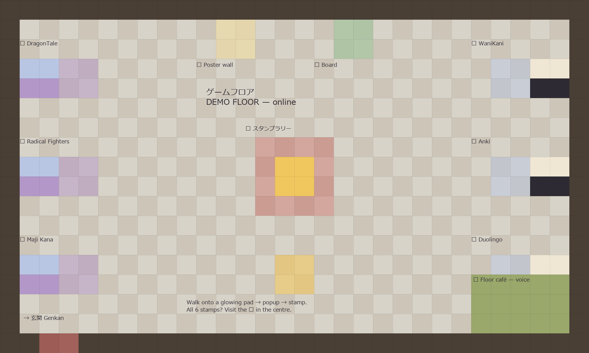

# Demo Floor (online) — guide

The session-1 workshop demo floor as a shareable WorkAdventure room, for the people who
couldn't attend in person. Museum + arcade, per the design catalog (`DESIGN.md` §3/§5):
**arcade wing** (left) = the kanji games themselves, **museum wall** (right) = the industry
apps they get compared to, **stamp rally** across all six stations, 🏆 trophy pedestal with a
finisher counter, 📜 poster wall, 📌 common board, 🍵 jitsi café corner, exit to the Genkan.



## Files
- `gen_floor_maps.py` → `maps/floor/floor.tmj` (standalone; never touches genkan/commons/lab/tileset)
- `scripts/floor/floor.js` — all behavior; CONFIG block on top, graceful when URLs are empty
- Regenerate: `py gen_floor_maps.py` · syntax check: `node --check scripts/floor/floor.js`

## Share link (after push)
Pages deploy serves the map at
`https://dpenl.github.io/kanjiWorkAdv/maps/floor/floor.tmj`, playable at:

```
https://play.workadventu.re/_/global/dpenl.github.io/kanjiWorkAdv/maps/floor/floor.tmj
```

This is the anonymous/public route — fine for a shared tour link. Research-corpus figure:
WA free tier ≈ **10 concurrent** users (shrank from 14; re-verify before inviting more at once).

## The six stations
Walking onto a glowing pad opens the popup; the **▶ Open / Stamp** button collects the stamp
(clicking through counts as "tried" — so stations without an online build are still stampable).

| Station | Kind | Online today | ✎ yours to fill (CONFIG in `scripts/floor/floor.js`) |
|---|---|---|---|
| DragonTale | 🕹 arcade | popup only | `url` when a web build exists |
| Radical Fighters | 🕹 arcade | popup only | `blurb` (your one-liner) + `url` |
| Music to My Ears / Maji Kana | 🕹 arcade | popup only | `blurb`, `prompt`, `url` (build availability was already ✎ on the physical floor) |
| WaniKani | 🏛 museum | opens wanikani.com in new tab | — |
| Anki (plain deck) | 🏛 museum | opens ankiweb.net in new tab | — |
| Duolingo (Japanese) | 🏛 museum | opens duolingo.com in new tab | — |

Blurbs and try-prompts are taken verbatim from the session-1 game profiles
(`session1-materials/print/deck_data.py` PROFILES); the ✎-gapped ones ship empty rather than
invented. Museum links open in a **new tab** on purpose — those sites refuse iframes
(X-Frame-Options). If one of your games gets a web build on a host that allows embedding,
set `embed: true` and it opens as an in-world co-website instead.

## Completion quest (stamp rally)
- Stamp = clicking the popup's primary button at a station. Progress persists per player
  (`WA.player.state`, world-scoped) and shows on the 🎮 action-bar button.
- All 6 → chat fanfare + pointer to the 🏆 pedestal; the trophy popup shows the finisher
  counter (world variable `kc_floor_finishers`, declared in the map; best-effort on the
  public route — treat it as a toy, not a metric) and nudges people to leave a line on the 📌 board.
- Opt-in like the commons rally: no locked doors, nothing gated behind completion.

## Other zones
- **📜 Poster wall** — `CONFIG.posterUrl`, ships **empty** (graceful popup). Paste the
  session-1 materials hub link if this audience should get the cards + sheets.
- **📌 Board** — `CONFIG.boardUrl`, defaults to the existing `web/board.html` kiosk.
- **🍵 Floor café** — `jitsiRoom: kc-floor-cafe` for a stable voice spot (proximity bubbles
  work everywhere else as usual).

## Test protocol
Same as the lab (`LAB-REVIEW-GUIDE.md`): push → open the play URL in two browsers, walk all
six pads, check stamp count survives a reload, finish the rally in one browser and read the
trophy popup in the other. Not testable before push (hosted play needs the public URL).

## Known state
- **Not pushed** — repo commit policy: nothing goes public without David's go.
- Placeholder tileset by design (same 16-color palette as the lab); the known upgrade path
  is a re-skin from the official Tuto/LPC tilesets (CC-BY-SA, attribution files in the
  platform clone) — see `DESIGN.md` §1 requirements.
- Validated statically: JSON/layer sizes, JS syntax, zone↔CONFIG slug cross-check, popup
  anchors present, start-to-every-zone walkability flood-fill. Live behavior (popups,
  stamps, jitsi) untested until pushed.
